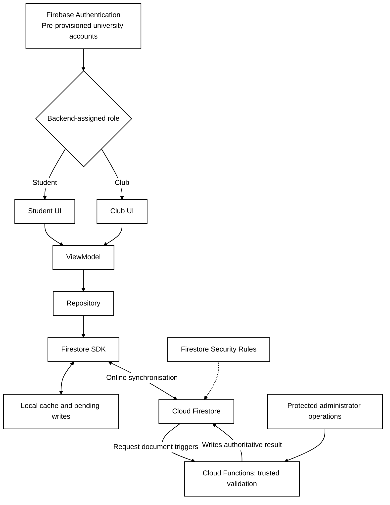
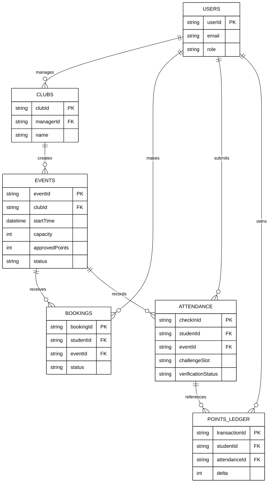
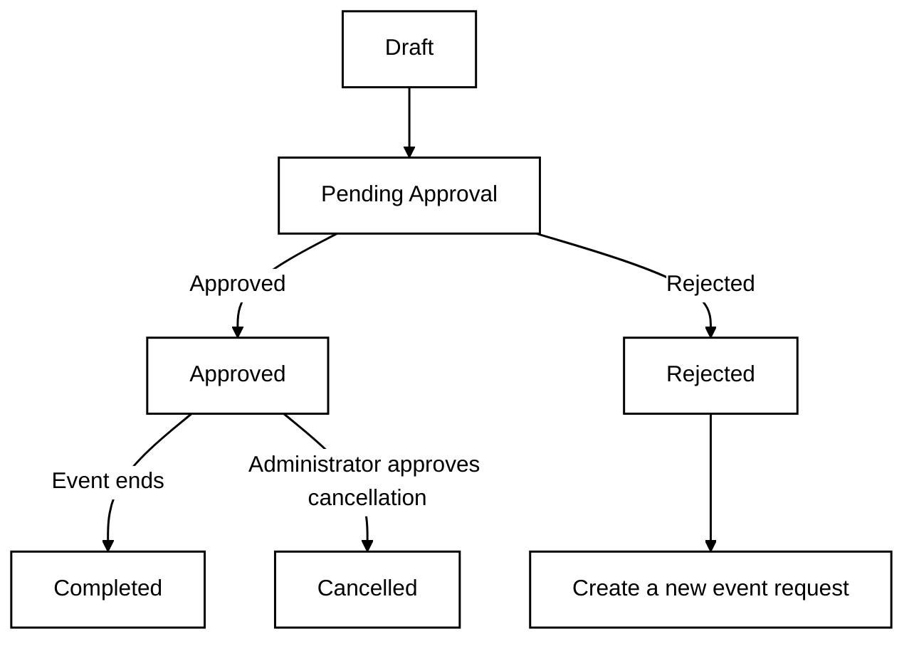

# 3.1-3.2 Architecture and Data

## 3.1 System Architecture

The Android application is developed using **Kotlin and the Android SDK** and follows **MVVM (Model–View–ViewModel)**. Student and club users see role-specific screens. The UI observes state exposed by a `ViewModel`, which calls a `Repository` to access data. Business decisions are not implemented directly in the UI.

Users sign in through **Firebase Authentication** using university accounts provisioned beforehand. Roles are assigned by the backend rather than selected by users on the device. **Cloud Firestore** stores shared users, clubs, events, bookings, attendance records and points data, and supports a local cache and queued offline writes. **Cloud Functions** performs trusted booking checks, attendance verification and points operations. Administrators approve event requests through protected backend operations; a separate administrator-facing Android application is not required.

MVVM was chosen to reduce coupling between the UI and business logic and improve maintainability and testing. We chose Firestore's built-in offline persistence over an additional Room and WorkManager queue to avoid duplicating synchronisation logic, although it provides less fine-grained control over retries and upload timing.

**Figure 1: System Architecture Diagram**

## 3.2 Data Model

The database contains six core collections:

| Collection | Example fields | Purpose |
|---|---|---|
| `Users` | `userId`, `email`, `role` | Account identity and role |
| `Clubs` | `clubId`, `managerId`, `name` | Club information and managers |
| `Events` | `eventId`, `clubId`, `startTime`, `capacity`, `approvedPoints`, `status` | Event details and approval status |
| `Bookings` | `bookingId`, `studentId`, `eventId`, `status` | Bookings, waitlists and cancellations |
| `Attendance` | `checkInId`, `studentId`, `eventId`, `challengeSlot`, `verificationStatus` | Check-in evidence and verification outcome |
| `PointsLedger` | `transactionId`, `studentId`, `attendanceId`, `delta` | Auditable points credits and reversals |

A club can create multiple events. Students and events are linked through `Bookings`, forming a many-to-many relationship. Each attendance record belongs to a specific student and event. Verified attendance can generate a points transaction; later invalidation produces a compensating negative entry. **Clients cannot directly edit a student's total points.**

**Figure 2a: Entity Relationship Diagram (ERD)**

### Event Status Flow and Business Constraints

**Figure 2b: Event Status Flow**

- Clubs **cannot directly edit approved events**; cancellations require administrator approval.
- A rejected proposal requires a new submission, rather than editing and resubmitting the existing one.
- Booking outcomes include `Pending`, `Confirmed`, `Waitlisted`, `Cancelled` and `Rejected`. Offline bookings are **provisional requests** until the backend checks capacity and scheduling conflicts.
- When a place becomes available, a waitlisted student receives a notification and must **confirm** the offered place; a notification alone does not guarantee a booking.

# 3.6 Points and Role Enforcement

Under the **latest proposed points rule**, points are credited immediately after **Cloud Functions** verifies a student's check-in. For offline attendance, points are awarded only after the record has been uploaded and verified. If a check-in is subsequently invalidated, an administrator records a compensating negative entry in `PointsLedger` and the student receives an explanation. Backend role checks and Firestore Security Rules prevent unauthorised actions such as a student approving events or a club awarding itself points. Hiding buttons in the UI alone is not an effective security control.

> **Difference from the earlier group draft:** The earlier decision was to credit points after event completion and administrator approval. This document follows the later proposed rule of **immediate credit after verified check-in**. Confirm alignment with Requirements Analysis and the UI workflows before final submission.
