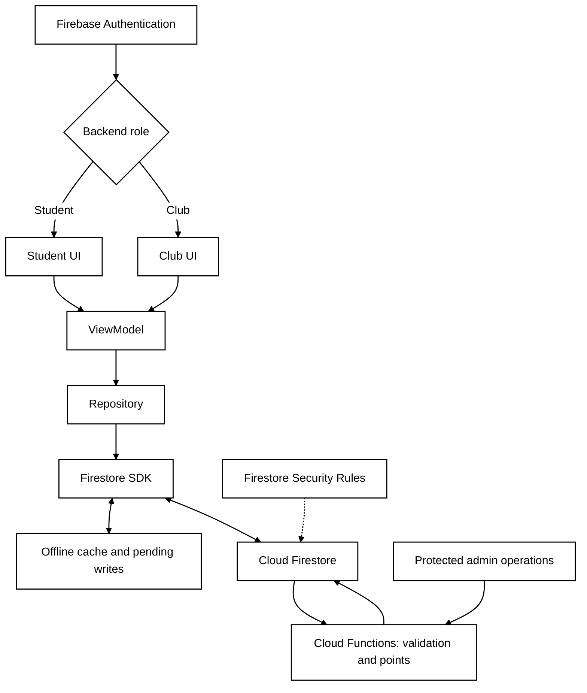
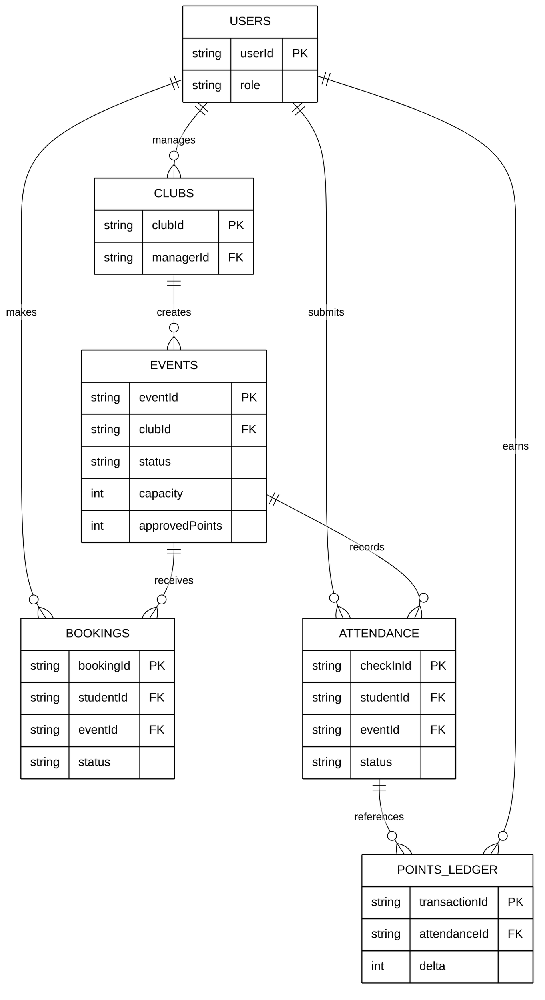
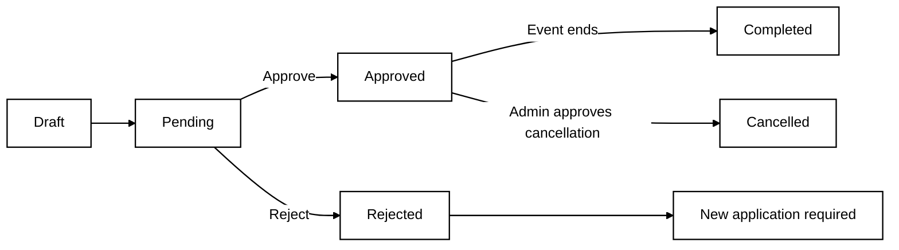

# 3. Technical Design — Architecture and Data

## 3.1 System Architecture

The Kotlin Android app uses MVVM: student and club interfaces observe ViewModels that call repositories. Pre-provisioned university accounts use Firebase Authentication; server-assigned roles control navigation. Firestore stores shared data and queues offline writes; Cloud Functions validates bookings, attendance and points. Clients submit requests but cannot directly write verified attendance or points. Administrators approve events through protected backend operations. **Drawbacks:** MVVM adds boilerplate compared with direct UI calls; Firebase creates vendor dependence; Firestore persistence offers less retry control than a separate Room/WorkManager queue.

**Figure 1 — System Architecture**

## 3.2 Data Model

Six collections support the app: Users, Clubs, Events, Bookings, Attendance and PointsLedger. Events follow Draft → Pending → Approved/Rejected → Completed/Cancelled; clubs cannot edit approved events, and cancellations need administrator approval. Bookings can be Pending, Confirmed, Waitlisted, Cancelled or Rejected; waitlisted students confirm offers. Server transactions check capacity and time clashes atomically, including competition for the final available place. Attendance keeps unique requests and verification results. An append-only ledger records credits and reversals. **Drawbacks:** Transactions require server access, unlike unreliable client-only checks; ledger entries use more storage than directly editing a points total but support auditing.

**Figure 2 — Entity Relationship Diagram**

**Figure 2b — Event Status Flow**

## 3.6 Points and Role Enforcement

Points are credited immediately after server-verified check-in; offline claims receive points only after validation. Invalid awards generate reversing ledger entries and notifications. Authentication, Security Rules and backend role checks restrict privileges. **Drawback:** Pre-provisioning accounts takes administrative effort, but self-selected roles and client-calculated points are insecure.
