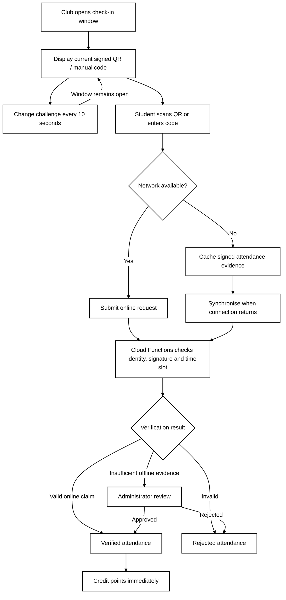

# 3.3–3.4 Attendance Design and Security Analysis

## 3.3 Attendance Design

A club can open a check-in window near the beginning of an event or during the event. **The QR code refreshes every 10 seconds; the overall check-in window does not close after 10 seconds.** The club can start and end the window manually; a **five-minute default** is proposed (**group confirmation required**). Each QR challenge includes an event identifier, a time-slot identifier, a nonce and a digital signature issued by the backend. A corresponding manual code provides an alternative when scanning is inconvenient. The previous manual code may be accepted for a **proposed additional 10-second grace period** to avoid expiration during entry (**to confirm**).

Before an event, the **club device** can preload a limited set of backend-signed challenges valid only within pre-authorised check-in time slots. If the club's network connection fails, the device can still display challenges in sequence. **Future valid challenges must not be distributed to students in advance**, because this would increase the risk of remote check-in.

For online check-in, Cloud Functions verifies the authenticated user's identity, the approved event, an existing booking or club-authorised walk-in, the QR signature, the valid server-time slot and duplicate attendance. For offline check-in, the student's app stores signed scan evidence locally and submits it when connectivity returns. **An offline claim cannot be accepted solely on the basis of a device timestamp.** The emulator demonstration can use a virtual camera or manual code entry.

**Figure 3: Attendance Verification Flow**

## 3.4 Security Analysis

Security decisions are performed on the backend rather than on a modifiable client. Digital signatures make forged QR challenges harder to submit; unpredictable manual codes and rate limits reduce guessing. Each student-event pair may have only one accepted attendance record, and idempotent backend processing prevents repeated uploads from generating duplicate points. Firestore Security Rules and Cloud Functions enforce role and operation permissions.

However, **a rotating QR code does not completely prevent remote check-in**. Someone physically present may share the current challenge with an absent student in real time. Even when an offline challenge carries a valid signature, the server cannot establish precisely when or where it was scanned; trusting a local timestamp does not solve this limitation. Suspicious or delayed offline records therefore require review, and club organisers can carry out random on-site spot-checks. Compared with BLE or NFC, this approach requires less specialised hardware and is easier to demonstrate on the emulator, but it cannot provide absolute proof of physical presence.

**Table 1: Attacks, Preventive Measures and Remaining Weaknesses**

| Attack | Prevention | Remaining weakness |
|---|---|---|
| Remote check-in | 10-second QR rotation, authenticated identity, on-site spot-checks | Current valid codes can still be shared live |
| Forged QR challenge | Backend signature and authorised-slot validation | Legitimate codes may be captured and forwarded |
| Manual-code guessing | Unpredictable codes and rate limiting | A valid code can still be shared |
| Duplicate submission / replay | Unique student-event attendance key and idempotent processing | A stolen account could still be abused |
| Forged offline capture time | Signed challenges, backend validation and manual review | Actual scan time cannot be independently proven |
| Privilege escalation | Server-assigned roles and Firestore Security Rules | Stolen privileged credentials remain a risk |
| Points tampering | Backend-only ledger writes and reversal entries | Administrative mistakes or compromised accounts |
