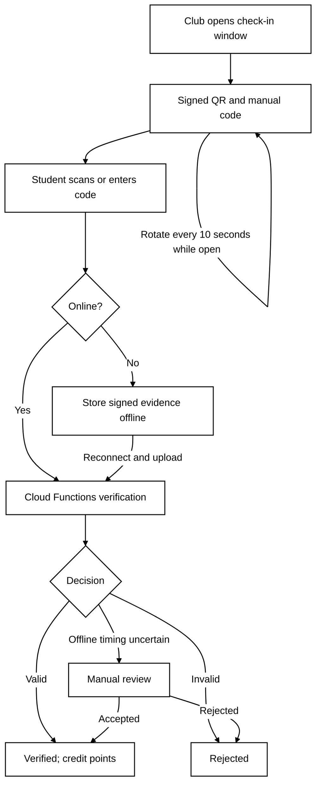

# Technical Design — Attendance and Security

## Attendance Design

Clubs open a check-in window (proposed default: five minutes), during which signed QR and matching manual codes refresh every ten seconds. A proposed ten-second grace period allows completion of manual entry. Clubs prefetch backend-signed, time-limited challenges so codes remain displayable offline. Students scan or enter a code; Firestore queues offline evidence. Cloud Functions checks identity, approved event, booking or authorised walk-in, signature, permitted server-time slot and duplicates. The emulator supports manual entry or a virtual camera. Online checks use server time, whereas offline uploads cannot prove the actual scan time. 

**Drawbacks:** Short rotations challenge crowded rooms; grace periods facilitate sharing; preloaded codes may leak from compromised devices. GPS-only verification was rejected because indoor location is unreliable.

**Attendance Verification Flow**

## Security Analysis

Signatures deter forgery, unpredictable manual codes and rate limits deter guessing, and unique student–event keys prevent repeated awards. Server-side permissions protect approval and points operations. However, live QR sharing can enable remote check-in, and an offline signed token cannot prove the student's actual scan time or physical presence. Uncertain offline claims therefore require organiser or administrator review before points are credited. 

**Drawbacks:** Manual checks increase workload; BLE/NFC proximity methods might provide stronger evidence but require hardware and emulator workarounds. No proposed method eliminates impersonation completely.

**Security Threat Analysis**

| Attack | Prevention | Remaining weakness |
|---|---|---|
| Remote check-in | Rotating QR; spot-checks | Live forwarding |
| Forged or guessed codes | Signatures; rate limits | Valid codes can leak |
| Repeated requests | Unique keys; idempotency | Stolen accounts |
| Fake offline time | Signed slots; manual review | Scan time unprovable |
| Privilege abuse | Backend roles; ledger | Admin compromise |
