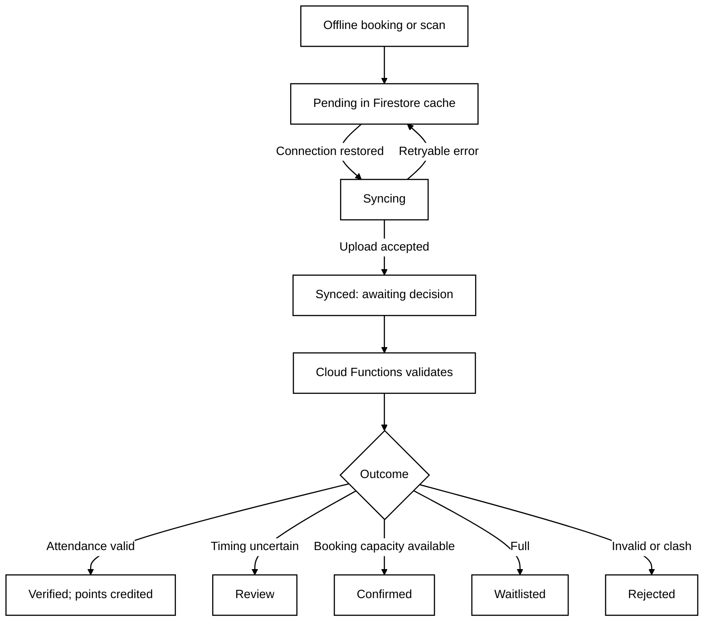

# Technical Design — Offline Synchronisation

## Offline Synchronisation

Firestore persistence caches event data and queues booking/check-in requests with stable IDs and signed evidence. The UI separates Pending, Syncing and Synced (uploaded) from Verified, Review and Rejected (server decisions). On reconnection, queued writes reach Firestore and trigger Cloud Functions validation. Offline bookings remain provisional until server transactions check capacity and clashes; outcomes include Confirmed, Waitlisted or Rejected. Unverifiable offline attendance enters Review and earns no points until approved. Stable IDs and idempotent processing prevent duplicate awards during retries. Firestore pending-write metadata identifies unsent local changes; separate backend outcome records establish verification. Listeners display outcomes and explanations. 

**Drawbacks:** Firestore offers limited retry scheduling and cached capacity may be stale, while manual review delays some credits. Online-only check-in was rejected because it fails R4.

**Offline Synchronisation Flow**

