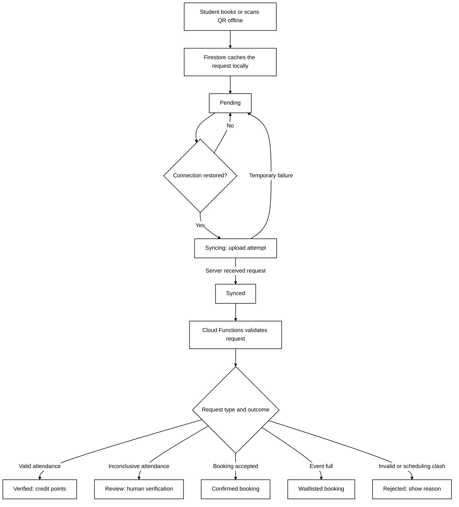

# Section 3.5 — Offline Synchronisation

## 3.5.1 Local Storage and Synchronisation

When a student's phone is offline, the Firestore SDK can read previously downloaded event data from its persistent local cache and queue booking or attendance request documents for later upload. Each request includes a stable `requestId`, student and event IDs, relevant signed QR challenge evidence, and necessary local action metadata. When the network returns, Firestore synchronises pending writes with the backend. Cloud Functions then verifies the request and writes the **authoritative business outcome** to Firestore.

Two distinctions are essential:

1. **Saved locally does not mean booked or checked in successfully.** A delayed booking may become waitlisted when capacity is exhausted, or be rejected due to a time clash.
2. **Synced does not mean Verified.** A check-in must pass backend validation before points are awarded; inconclusive offline evidence requires review.

## 3.5.2 Request Statuses

| Status | Meaning | Student-facing message |
|---|---|---|
| `Pending` | Saved locally and awaiting upload | "Saved offline. Waiting for a connection." |
| `Syncing` | An upload attempt is in progress (app-level state) | "Synchronising..." |
| `Synced` | Backend has acknowledged receipt | "Uploaded. Awaiting verification." |
| `Verified` | Backend has accepted the attendance | "Check-in verified. Points credited." |
| `Review` | Offline evidence requires human review | "Waiting for administrator review." |
| `Rejected` | Request did not pass validation | "Check-in rejected" plus the reason |

Booking requests have distinct business outcomes, such as `Confirmed`, `Waitlisted`, and `Rejected`. **Do not use `Verified` to mean that a booking is confirmed.**

## 3.5.3 Offline Synchronisation Flow

**Figure 4 — Firestore Offline Synchronisation and Backend Validation**

## 3.5.4 Conflict Resolution and Security

The backend rechecks event capacity and schedule overlap in transactions; **available places shown in an offline cache cannot be treated as authoritative**. Requests use stable unique IDs and idempotent server-side processing, so network retries or duplicate Cloud Functions triggers cannot confirm the same booking twice or award duplicate points. Firestore pending-write metadata and listeners for backend results help update the interface. The `Syncing` label must be implemented using application state; it is **not a separate Firestore business status provided automatically by the SDK**.

Firestore offline persistence was chosen over online-only submissions to meet R4. The trade-off is the need to handle delayed synchronisation, stale caches, conflicting bookings, and uncertainty about the authenticity of offline attendance evidence.
